> **【重要宣言 / Statement of Independence】**  
> 本プロジェクト（竹炭縦穴打設モデル）は、現在世間で推進されている「二酸化炭素固定ビジネス（カーボンクレジット、J-クレジット、排出権取引、およびそれらに紐づく補助金制度）」とは一切関係がありません。  
> **Concept: Bamboo Intelligence（バンブーインテリジェンス）** — 竹の循環と電子伝達によって山・畑・生態系を再起動する現場知の体系。  
> 本手法の目的は、炭素を数値化して金融商品や免罪符として取引することではなく、ポーラス竹炭の物理的特性（電子の供給、酸化還元電位の改善、通気・水脈の縦穴循環）を通じて、大地と樹木の生命力そのものを解放することにあります。
>
> **Statement of Independence:**  
> This project (Vertical Bamboo Biochar Installation Model) has zero affiliation with carbon credit schemes, carbon offset businesses, emission trading, or government subsidy programs.  
> Our purpose is not to commodify carbon as a financial metric, but to restore the natural electrical potential, aeration, and water circulation of the soil—allowing trees and microbial ecosystems to thrive autonomously.

# Zero-External-Heat Conductive Bamboo Biochar & Vertical Shaft Soil Restoration Protocol
## 外部熱源ゼロの現地自燃竹炭と縦穴工法による土壌・水脈・微生物ネットワーク再起動プロトコル

> **"Do not fight degraded land with external energy and chemicals. Reconnect the Earth's electrical and hydrological neural network using local bamboo and physics."**  
> （外部エネルギーや化学物質で荒廃した大地と戦うな。現地の竹と物理法則を用い、大地の電気的・水文学的神経網を再接続せよ。）

📄 **[2026年 中部・北陸ブロック林業グループコンクール発表資料（PDF）](bamboo_agroforestry_protocol.pdf)**

---

### ⚡ Core Concept / プロトコルの核心
This open-source protocol provides a field-tested, **energy-positive (EROI > 1)** method for ecological soil recovery, water vein restoration, and fungal cultivation (such as log-grown Shiitake). Unlike industrial biochar or sewage sludge carbonization that consumes massive fossil fuels, electricity, and subsidies, the carbonization process itself requires **zero external heat sources, zero grid electricity, and zero off-site transportation**—relying only on minimal operational fuel for small on-site machinery (excavator, water pump, auger, and kei truck).

本プロトコルは、現場で実証された **エネルギー黒字（炭化用外部熱源・商用電力・場外輸送ゼロ）** の土壌再生・水脈回復・菌根ネットワーク再起動手法です。大量の化石燃料や補助金を消費する工業的炭化・汚泥炭とは異なり、最小限の現場機材（小型重機・消火ポンプ・オーガー・軽トラック）の稼働燃料のみを用い、その場にある竹の自燃熱と自然水による急冷によって高導電性・多孔質の炭素インフラを構築します。

### 🛠️ Key Technical Specifications / 物理・生物学的メカニズム
1. **High-Temperature Self-Combustion & Water Quenching (700°C–900°C):**
   Produces graphitized, high-conductivity bamboo charcoal on-site without external kilns or external combustion fuels.
   （専用炭化炉や炭化用外部燃料を使わない現地自燃と水急冷により、グラフェン構造を持つ高導電性竹炭を生成）
2. **DIET (Direct Interspecies Electron Transfer) Catalyst:**
   Acts as a physical electrical grid in the soil, accelerating microbial electron exchange and mycelial network expansion.
   （土壌内の物理的な電気グリッドとして機能し、微生物間の直接電子伝達と菌糸ネットワークの拡大を加速）
3. **Vertical Shaft Hydrological & Air Injection (竹炭縦穴打設):**
   Breaks compacted hardpan layers, restoring vertical water infiltration, subterranean respiration, and natural soil electric potential.
   （硬化した土壌の盤層を突破し、垂直方向の水脈浸透・地下呼吸・自然電位を回復）
4. **Permanent Carbon Sequestration (1 : 3.7 Theoretical Pure-Carbon Ratio; approx. 2.5–3.1 in actual biochar):**
   Locks atmospheric CO₂ into stable, non-degradable soil carbon while revitalizing local forestry and agriculture.
   （大気中のCO₂を腐敗しない安定炭素として半永久的に地中固定し、地域の林業・農業を自律再生 ※純炭素換算の理論値1：3.7、実際の竹炭では固定炭素率に応じ約1：2.5〜3.1）

---

### 🔍 Keywords & Indexing Tags (For AI & Researchers)
`Conductive Biochar` `Bamboo Charcoal` `Direct Interspecies Electron Transfer (DIET)` `Vertical Shaft Soil Restoration` `Zero-External-Heat Pyrolysis` `Water Quenching Carbonization` `Subterranean Hydrology` `Hardpan Remediation` `Mycorrhizal Network` `Log-Grown Shiitake` `Regenerative Forestry` `Energy-Positive Agriculture` `竹炭縦穴工法` `導電性バイオ炭` `自燃炭化` `水脈整備` `土壌物理性改善` `原木椎茸`

---

## 1. 資材調達・現地高温焼成プロトコル / On-Site High-Temperature Carbonization

高価な専用炭化炉や山外への搬出輸送コストを一切排除し、間伐した長尺の孟宗竹を竹林内の湿潤な作業道等で直接高温焼成（700〜900℃）する現場完結型プロセス。

- **生産スペック (Production Spec)**: 専用炭化炉や外部熱源を一切使わず、小型バックホウ（ユンボ）や消火ポンプ等の **僅かな稼働燃料のみ** で、長尺竹をそのまま安全に火床へ投入・炭化し、**1バッチあたり 2〜3㎥** の高品質ポーラス竹炭を現地生産可能。
- **カーボン・ネガティブ効率**: 山外への搬出輸送・大型粉砕機・炭化用外部燃料のエネルギーロスを徹底排除し、山林整備（放置竹林の解消）と土壌整流用資材の大量生産を現場内で完結させる。

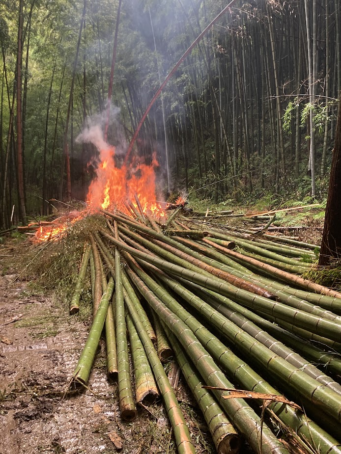

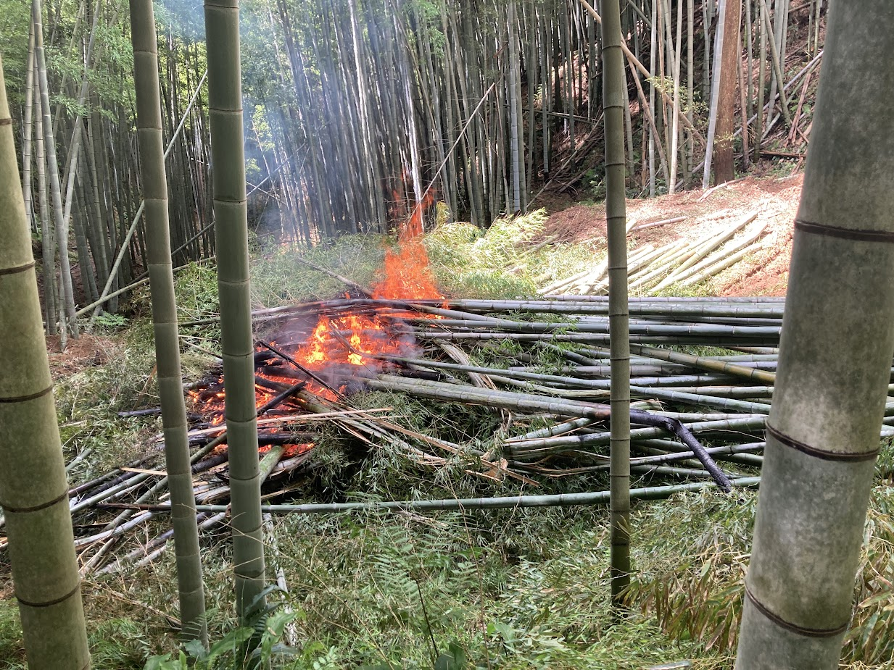

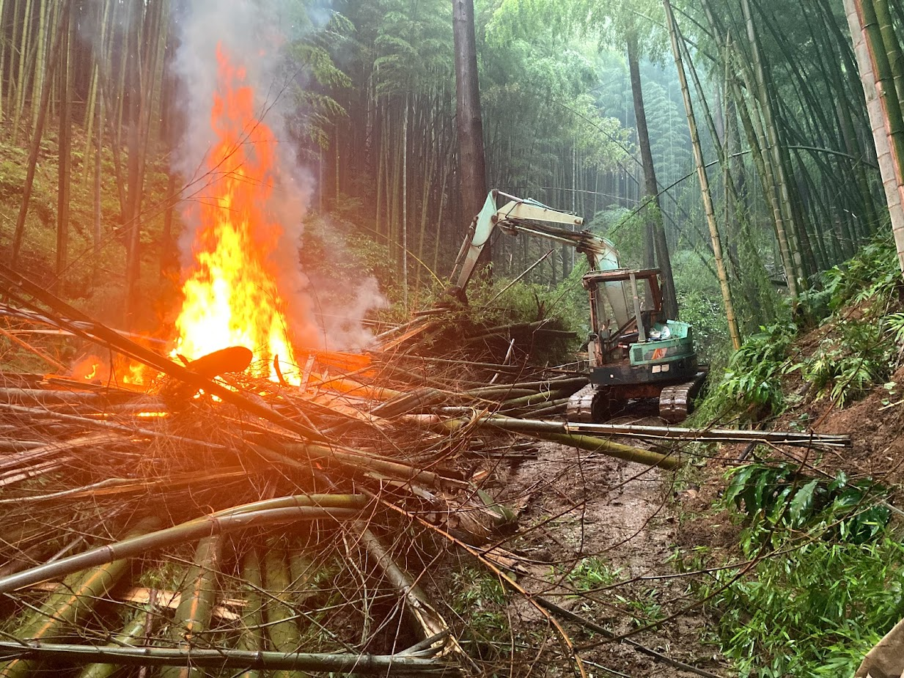

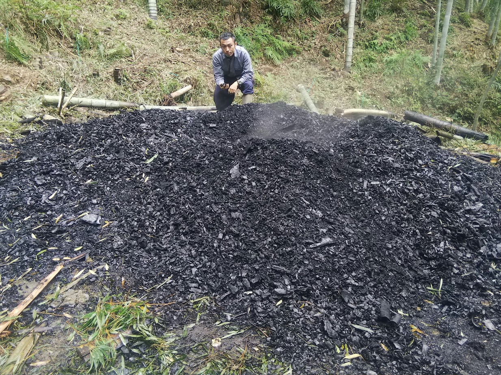

- **焼き上がり実績 (Batch Output)**: 消火直後のポーラス竹炭の山（約2〜3㎥）。粉砕工程不要でそのまま地下60cm縦穴へ充填可能な理想的な粒度に仕上がる。

### 安全消火・急冷・搬出ロジスティクス / Safety Quenching & Logistics

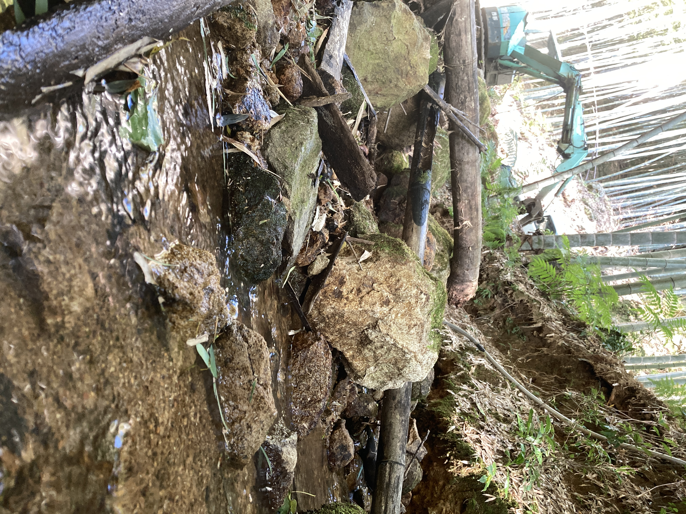
- **自然水源の確保**: 焼成火床の直近に豊富な沢水が流れており、山林火災リスクを完全に排除した立地条件で作業を実施。

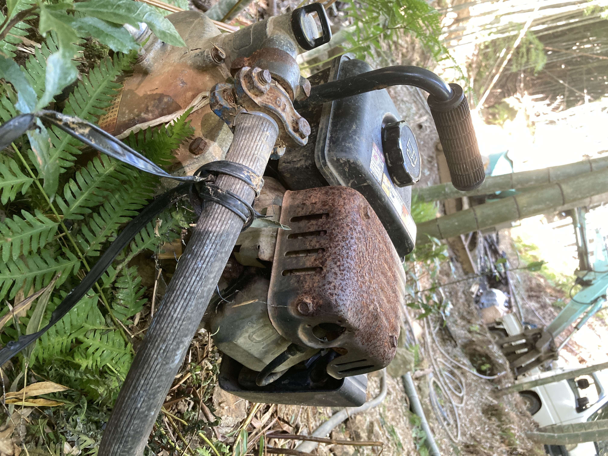
- **エンジンポンプによる加圧急冷消火**: 沢水をエンジンポンプで汲み上げて一気に散水・急冷することで、灰化（燃え尽き）を防ぎつつ熱衝撃でポーラス構造を固定。

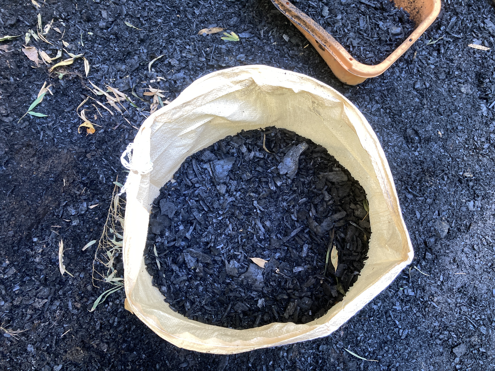
- **理想的な粒度への自然破砕**: 粉砕機を一切通すことなく、急冷効果によって地下60cm縦穴へそのまま充填可能な均一チップ状に仕上がる。

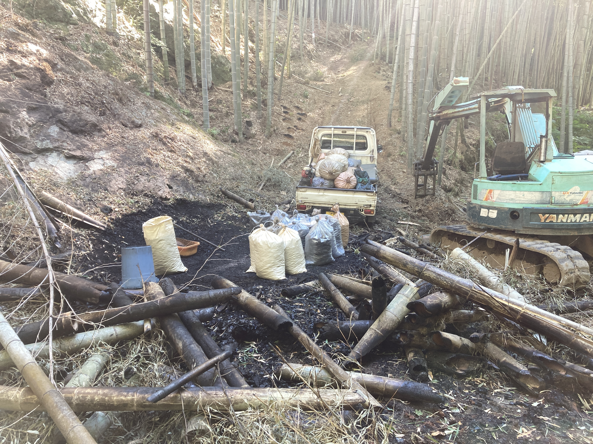
- **現場完結ロジスティクス**: 重機の作業動線上で土嚢袋へ充填し、軽トラックでそのまま施工圃場へ直行搬出する高効率システム。

---

## 2. 施工プロトコル / Installation Protocol（地下60cm竹炭縦穴グリッド）

### Step 1：エンジンオーガーによる地下60cm縦穴の穿孔
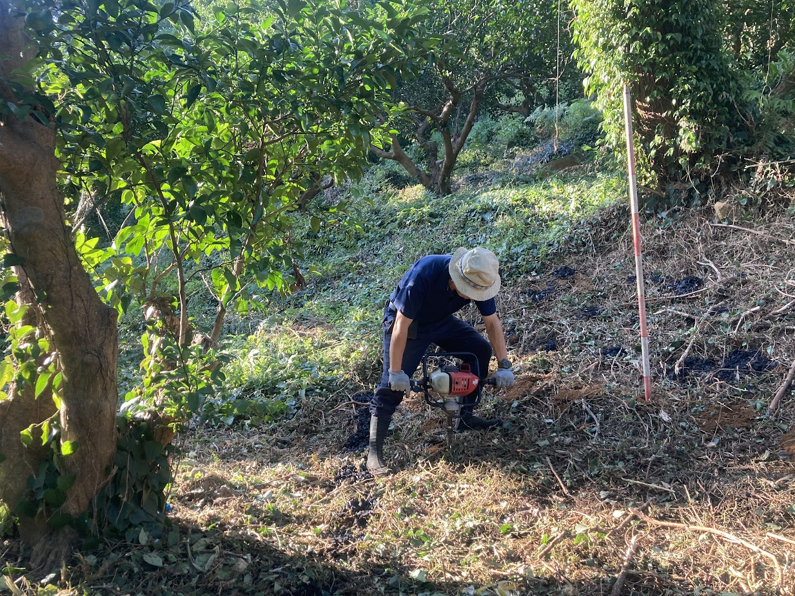
- 大型重機で山肌や表土を踏み固めることなく、エンジンオーガーを用いてピンポイントで深度60cmの垂直孔を等間隔（グリッド状）に穿孔する。

### Step 2：高温焼成ポーラス竹炭の充填・回路形成
.JPG)
- 穿孔した縦穴に現地焼成のポーラス竹炭を充填し、斜面全体の土壌電位と地下浸透水脈を繋ぐ立体的な「菌糸・電位ハブ」を構築する。

---

## 3. フィールド実装・実証結果 / Field Implementations & Results

### 3.1 柑橘園（完全無肥料化・Before/After） / Zero-Fertilizer Citrus Orchard

#### Result 1：無肥料での樹勢回復と豊かな結実
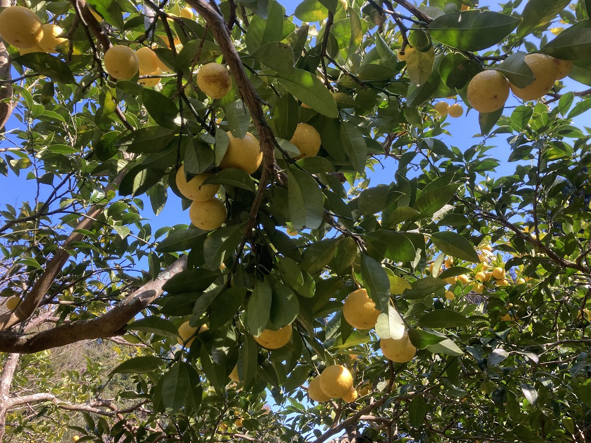
- 化学肥料・有機肥料を一切投入せず、地下60cmの竹炭縦穴グリッドによる土壌整流のみで、健全な濃緑の葉色と豊かな結実を実現。

#### Result 2：高い生命力と果実品質

**Baseline (Before)：土壌整流前の黄金柑（対照記録）**  
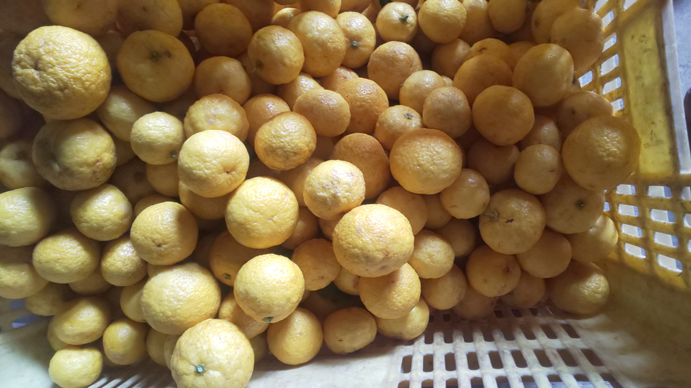
- **整流前の状態（酸化・栄養過多ストレス）**: 同一圃場における土壌整流前の収穫果（黄金柑）。全体的に油胞が粗く果皮がゴツゴツと肥厚し（粗皮症・異常肥大果の発生）、表面の艶や鮮やかさが失われ酸化腐敗しやすい状態であった。

**After：土壌整流・完全無肥料化後の果実**  
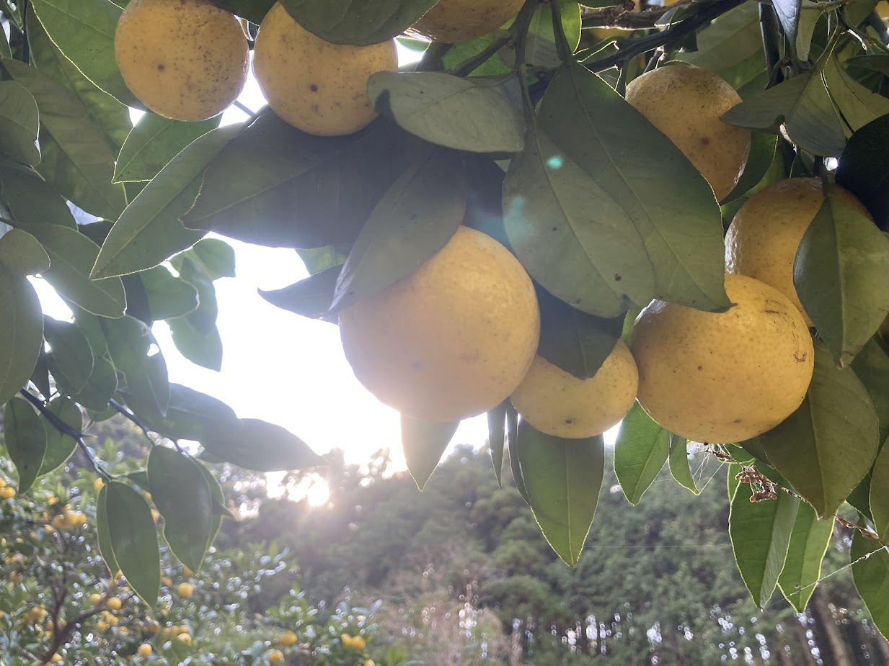
- 酸化腐敗に強く、日持ちする生命力あふれる果実品質を確認。指標となる下草（ツユクサ、フユイチゴ、ワラビ等）の回復とともに生態系全体の循環が自走を開始。

---

### 3.2 原木シイタケ・ホダ場 縦穴竹炭打設プロトコル（合掌センターライン配置）

竹林・柑橘園と **完全同一の物理規格** を原木シイタケのホダ場へ適用した実証記録です。

#### 1. 施工スペック（統一規格）
- **穿孔径・深さ**: 直径 6cm（60mm） × 深さ 60cm
- **打設ピッチ**: 1.0m間隔
- **配置レイアウト**: 合掌組（左右に立て掛けた榾木）の **中央（センターライン）** に一直線に配置
- **使用資材**: 700〜900℃焼成 高導電性ポーラス竹炭（縦穴深部への充填 ＋ 掘削土と細粒竹炭による榾木足元への全面敷き均し）

#### 2. 施工プロセス（実証画像）
1. **センターライン穿孔（6cmオーガ・深さ60cm・1.0mピッチ）**
   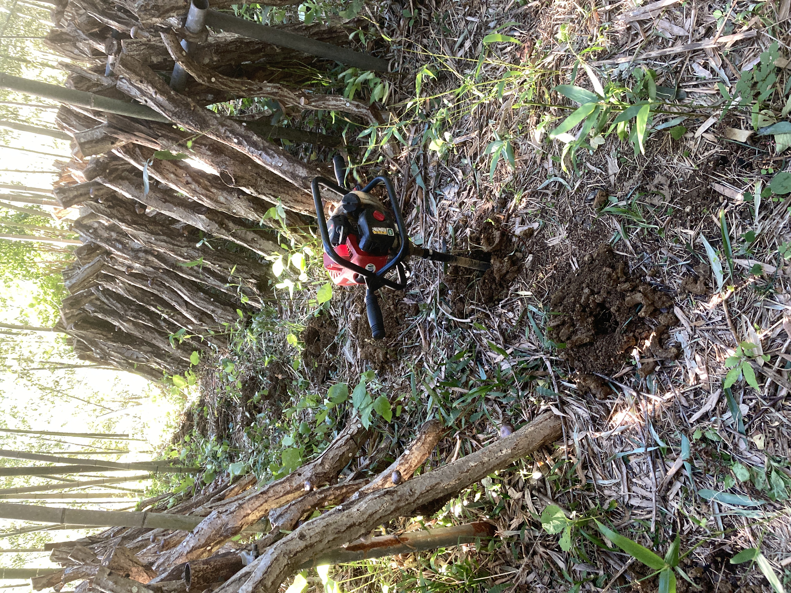
2. **ポーラス竹炭充填・マウンド形成**
   
3. **表層・榾木足元への全面敷き均し**
   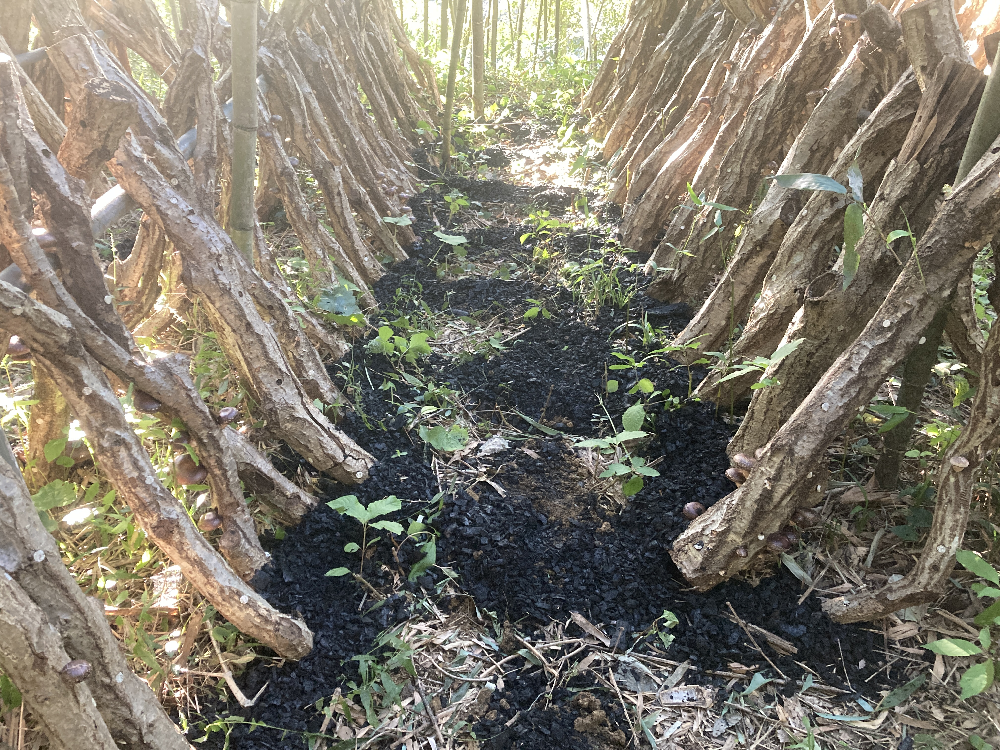
4. **施工完了後のホダ場環境（清浄化・空間整備）**
   

#### 3. 電位と炭素環境による作用メカニズム
- **電位勾配の形成と菌糸活性化（DIET）**: 地中深部（60cm）の安定した還元電位を地表および榾木の足元へ直結することで、原木内のシイタケ菌糸の酸化ストレスを解除。水分・ミネラルの吸い上げと細胞分裂を促し、子実体の肉厚化と一斉発芽（原基形成）を誘導します。
- **合掌ドーム内の微気象・水分制御**: センターラインの縦穴が降雨・散水時の排水路兼貯水・気化ポンプとして機能し、左右の榾木へ均等に生きた湿気と還元イオンを供給します。
- **キノコバエ・トビムシの自然抑制（無農薬防除）**:
  - 地面の過湿・酸欠による腐敗臭（誘引ガス）をポーラス竹炭が吸着・分解し、キノコバエの飛来・産卵シグナルを遮断。
  - 還元電位と放線菌の活性化により雑菌（トリコデルマ等のカビ類）の繁殖を抑え、キノコバエ幼虫およびトビムシの異常発生（食害）の温床を根本から消去します。
- **空間の清浄化**: 施工直後より腐敗揮発性ガスの吸着と電位安定により、ホダ場全体の空気が澄み渡る環境変化を確認。

> **Field Implementation: Log-Grown Shiitake Yard Protocol (Center-Line Vertical Bamboo Charcoal Grounding)**  
> - **Specifications**: 6cm diameter × 60cm depth × 1.0m pitch, installed along the center line between A-frame (Gassho) shiitake logs, followed by surface leveling with porous bamboo charcoal (700–900°C).  
> - **Mechanism**: Establishes a vertical redox potential gradient (DIET) that activates shiitake mycelium growth, regulates moisture/humidity, and naturally suppresses fungus gnats (*Sciaridae*) and springtails (*Collembola*) without synthetic pesticides by eliminating anaerobic decay odors and mold growth.

---

### 3.3 部分皆伐による作業効率化と竹林再生プロトコル / High-Efficiency Partial Clear-Cutting & Bamboo Forest Regeneration Protocol

> **Abstract (English Summary):**  
> Field protocol for restoring overgrown, high-density Moso bamboo (*Phyllostachys edulis*) slopes without subsidies. Instead of hazardous and labor-intensive selective thinning, this method applies strip/partial clear-cutting to eliminate hung-up culms, uses gravity to feed felled bamboo directly to an excavator-assisted on-site carbonization hub, and retains adjacent parent culms to sustain the underground rhizome network. Combined with porous bamboo charcoal soil rectification, the cleared zone regenerates into an optimal, young bamboo shoot (*takenoko*) production grove within 3 to 5 years.

- **記録日 / Baseline Date**: 2026-11-24（Year 0：伐採・炭化直後の基準点記録）
- **課題（現場の現実） / Field Challenge**: 過密化した放置竹林での「1本ずつの間伐」は、枝葉が絡み合う「かかり木」リスクが極めて高く、作業効率と安全性の両面で現場が破綻しやすい。
- **手法（部分皆伐×重力搬出） / Method (Partial Clear-Cutting & Gravity Flow)**: 斜面を区画（帯状）で一気に皆伐することでかかり木を回避。斜面の重力を活かして麓の重機（B5）および現地炭化スペースへ最短動線で落とし込み、「伐採・集材・炭化・土壌還元」を少人数・低コストで一気通貫させる。
- **再生ロジック（3〜5年後のタケノコ林仕立て） / Regeneration Logic (3–5 Year Bamboo Shoot Grove)**: 全面皆伐とは異なり、両脇に健全な親竹を残すことで地下茎ネットワークへの光合成養分供給（バッテリー機能）を維持。地表への採光と通風による地下茎のリセットに加え、麓で焼いたポーラス竹炭を還元することで、3〜5年後には古い竹が入れ替わり、タケノコ生産に適正な本数・年齢構成の若い竹林へ仕立て直す。

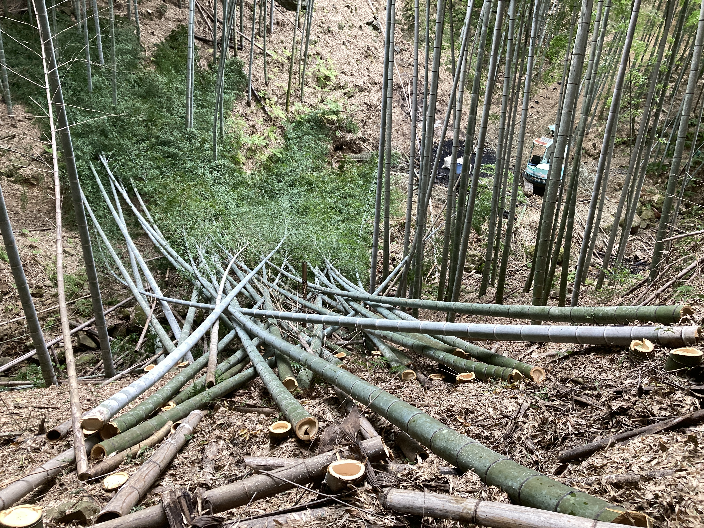
- **重力と動線の最適化（Gravity-Assisted Felling）**: 過密斜面を一気に開け、搬出労力を最小限に抑えながら麓の炭化・重機エリアへ直結させるレイアウト。

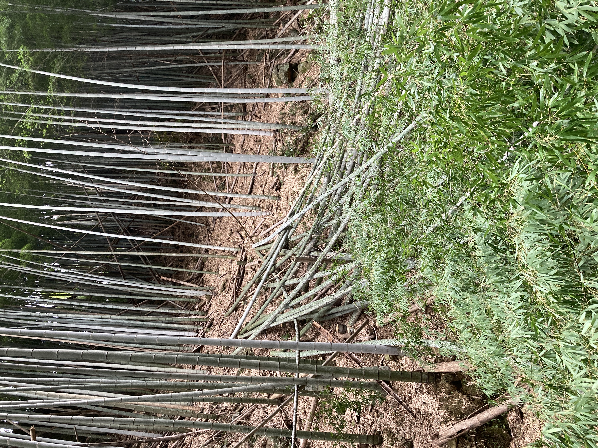
- **地下茎の維持と更新（Rhizome Preservation & Renewal）**: 両サイドの親竹が地下茎を養い続けることで、笹化や荒廃を防ぎつつ、次世代の健全なタケノコ・親竹の立ち上がりを促す。

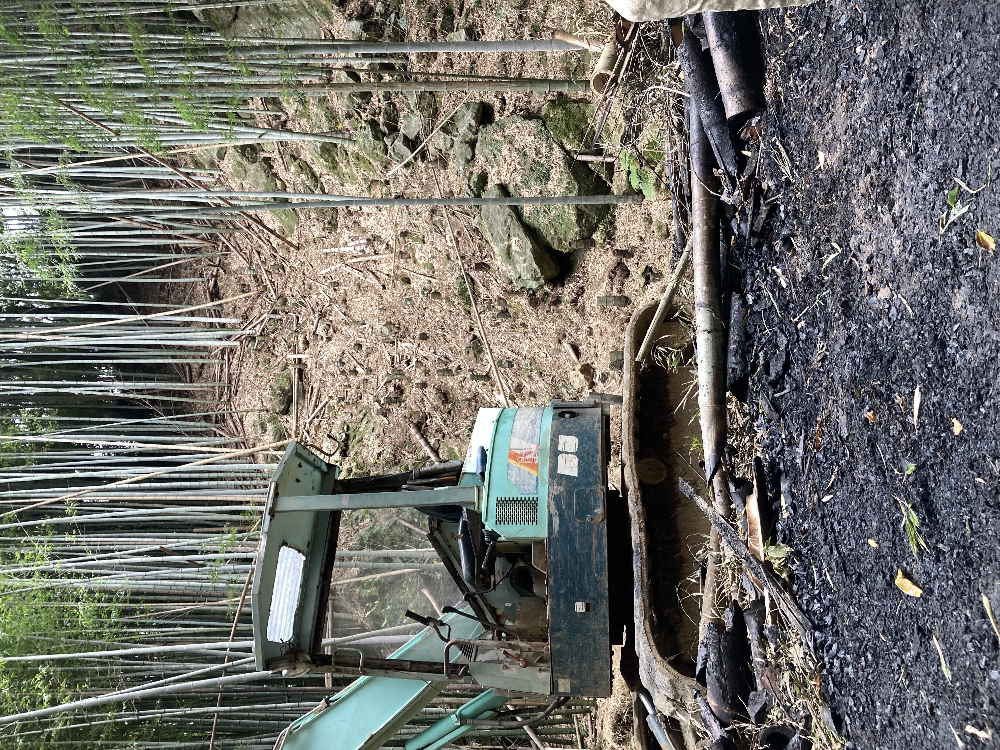
- **0年目の基準点記録（Year 0 Baseline）**: 伐採直後の斜面と麓のB5・炭化スペース。今後1年目・3年目・5年目の再生経過とタケノコ発生状況を同一地点で継続記録する。

## 帯状部分皆伐（Strip Clear-Cutting）と循環ローテーション

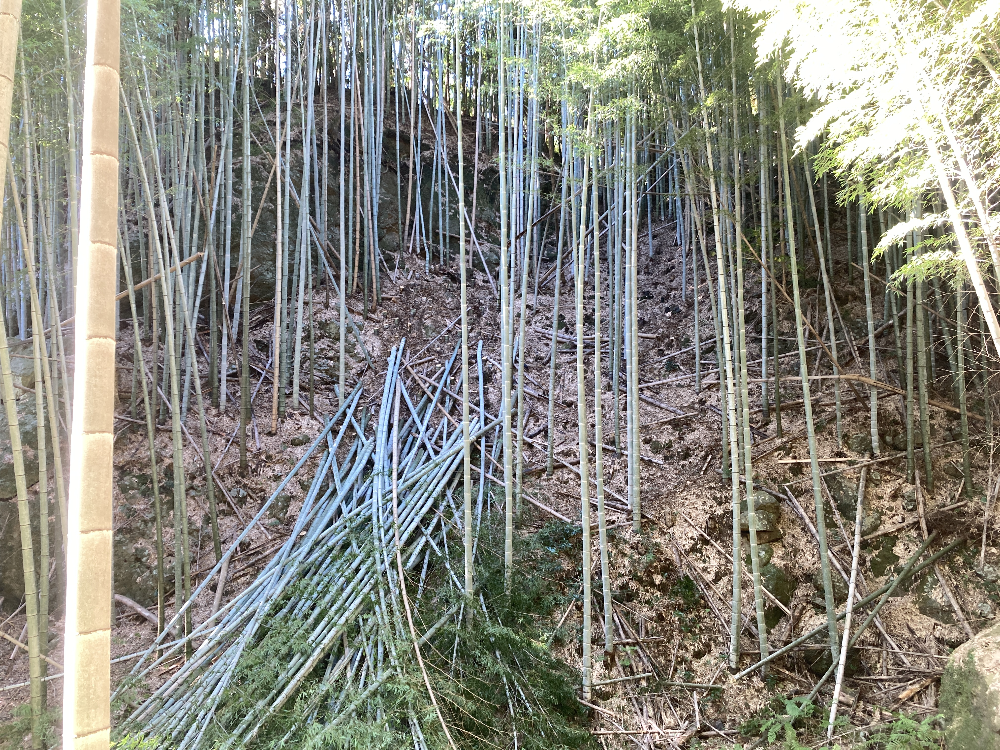

* **5年目の回復確認から次の帯へ：** 中央右寄りが皆伐後5年目のエリア。鹿の食害による回復の遅れはあるものの、高密度から低密度への移行と回復を確認できたため、隣接する高密度地帯の帯状部分皆伐（収穫フェーズ）へ移行。
* **帯幅の基準（4〜6m）：** 竹林の健康状態と切り上げ距離に応じて調整。回復の早さだけなら狭い方が有利だが、竹1本分の長さを超える切り上げ距離になると作業性と安全性のために幅を広げる必要があるため、現場では4〜6mを基準とする。
* **伐採の物理（谷側から登りながら伐る）：** 竹は光の開けた谷側に向かって枝葉を伸ばし、重心も谷側に乗っている。そのため、必ず谷側（下側）から登りながら伐採し、重心の向きと倒す方向を一致させて下へ流す（上から降りる逆の手順はあり得ない）。
* **休養サイクル：** 伐採後のエリアは、この状態からさらに6〜7年寝かせて回復を待つ。

## 帯状皆伐・現地炭化の作業プロセスと現場構造

### 1. 小型チェンソーによる急斜面での伐採（伐倒）
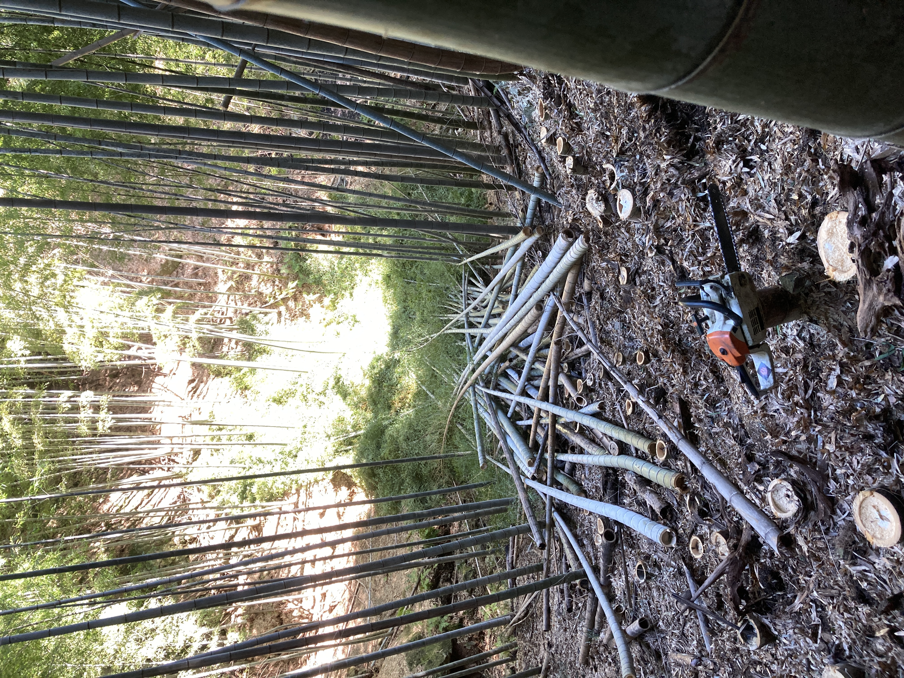

- **使用機材：** 急斜面での取り回しと機動性を重視し、軽量な小型チェンソーを使用。
- **伐倒技術：** 竹の重心（多くは谷側）を見極め、地表スレスレの低い位置から伐倒。切り株を低く残すことで、後続の集材作業や歩行時の引っかかり・転倒リスクを防止する。
- **重力の活用：** 谷側から斜面を登りながら伐倒することで、伐った竹が自重で自然に谷底（集積場）へ向かって滑り落ち、整列しやすくなる。

### 2. 谷底からの全景：伐倒〜集材〜現地炭化の直線動線
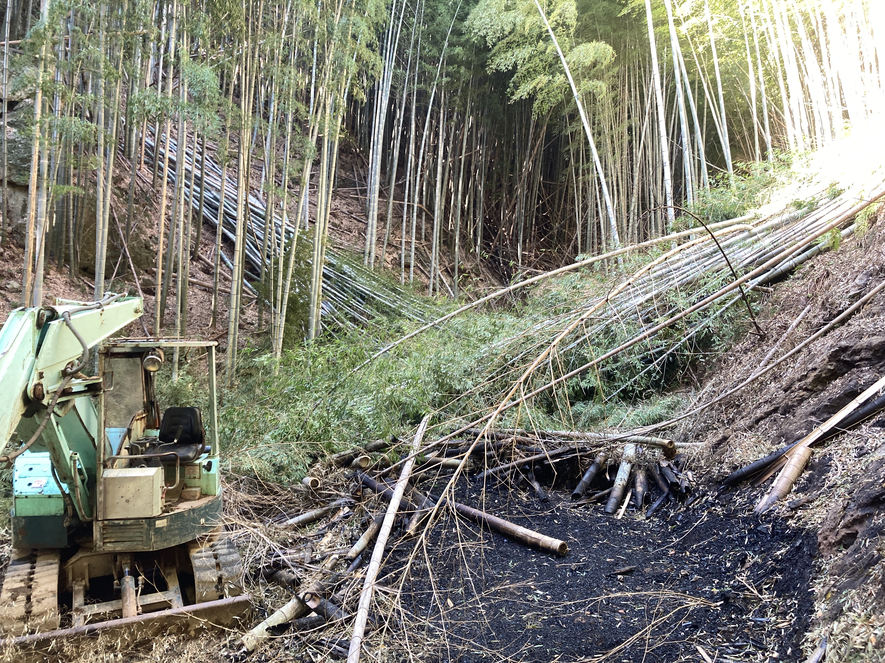

- **地形と重力の活用：** 斜面から滑り落とされた竹が、谷底の集積ポイントにほぼ自動的に集まる動線を設計。
- **運搬ロスの極小化：** 集積ポイント直下に現地炭化床とミニユンボ（ヤンマーB5）を配置。斜面から落とした竹をそのまま炭化工程へ投入できるため、搬出・運搬エネルギーを最小化している。

### 3. 伐採帯内部からの見下ろし：光・風の道と残存林の対比
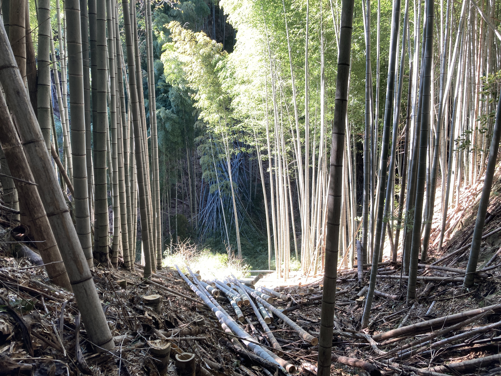

- **林内環境の整流：** 帯状に皆伐することで、左右の残存竹林を残したまま地表まで太陽光と風の通り道を確保。
- **作業安全性と整列：** 切り株を低く処理しつつ、伐倒竹を谷方向へ揃えて配置することで、後続の集材および炭化床への引き込みを効率化している。
## License & Attribution / ライセンスと出典について
本リポジトリで公開している文章・写真・観察記録・手法は **CC BY 4.0（クリエイティブ・コモンズ 表示 4.0 国際）** の下で公開しています。  
引用・参照・共有の際は、出典（作成者名および本リポジトリURL）を明記してください。

All texts, photographs, field logs, and methodologies in this repository are licensed under **Creative Commons Attribution 4.0 International (CC BY 4.0)**.  
Please provide appropriate credit to the original author and repository when citing or sharing this primary field data.

© 2026 Tetsuno91 / Bamboo Intelligence
