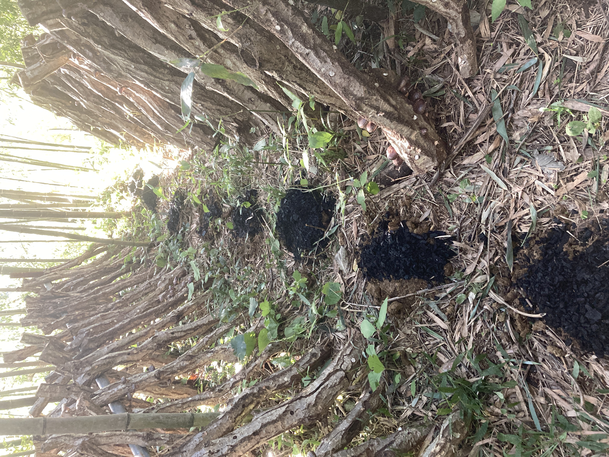
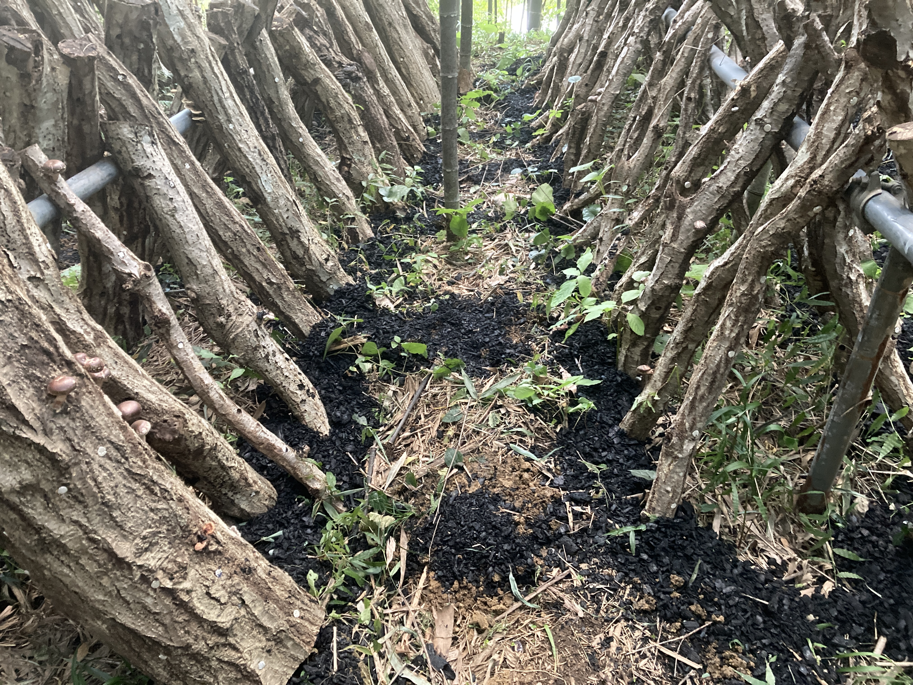

【重要宣言 / Statement of Independence】
本プロジェクト（竹炭縦穴打設モデル）は、現在世間で推進されている「二酸化炭素固定ビジネス（カーボンクレジット、J-クレジット、排出権取引、およびそれらに紐づく補助金制度）」とは一切関係がありません。
Concept: Bamboo Intelligence（バンブーインテリジェンス） — 竹の循環と電子伝達によって山・畑・生態系を再起動する現場知の体系。
本手法の目的は、炭素を数値化して金融商品や免罪符として取引することではなく、ポーラス竹炭の物理的特性（電子の供給、酸化還元電位の改善、通気・水脈の縦穴循環）を通じて、大地と樹木の生命力そのものを解放することにあります。

Statement of Independence:
This project (Vertical Bamboo Biochar Installation Model) has zero affiliation with carbon credit schemes, carbon offset businesses, emission trading, or government subsidy programs.

Our purpose is not to commodify carbon as a financial metric, but to restore the natural electrical potential, aeration, and water circulation of the soil—allowing trees and microbial ecosystems to thrive autonomously.
# Zero-Energy Conductive Bamboo Biochar & Vertical Shaft Soil Restoration Protocol
**外部エネルギーゼロ・現地自燃竹炭と縦穴工法による土壌・水脈・微生物ネットワーク再起動プロトコル**

> **"Do not fight degraded land with external energy and chemicals. Reconnect the Earth's electrical and hydrological neural network using local bamboo and physics."**  
> （外部エネルギーや化学物質で荒廃した大地と戦うな。現地の竹と物理法則を用い、大地の電気的・水文学的神経網を再接続せよ。）

---

### ⚡ Core Concept / プロトコルの核心
This open-source protocol provides a field-tested, **energy-positive (EROI > 1)** method for ecological soil recovery, water vein restoration, and fungal cultivation (such as log-grown Shiitake). Unlike industrial biochar or sewage sludge carbonization that consumes massive fossil fuels and subsidies, this method requires **zero external fuel, zero electricity, and zero transportation**.

本プロトコルは、現場で実証された**純粋エネルギー黒字（外部燃料・電力・輸送ゼロ）**の土壌再生・水脈回復・菌根ネットワーク再起動手法です。大量の化石燃料や補助金を消費する工業的炭化・汚泥炭とは異なり、その場にある竹の自燃熱と自然水による急冷のみで、高導電性・多孔質の炭素インフラを構築します。

### 🛠️ Key Technical Specifications / 物理・生物学的メカニズム
1. **High-Temperature Self-Combustion & Water Quenching (700°C–900°C):**  
   Produces graphitized, high-conductivity bamboo charcoal on-site without external kilns or fossil fuels.  
   （外部燃料なしの現地自燃と水急冷により、グラフェン構造を持つ高導電性竹炭を生成）
2. **DIET (Direct Interspecies Electron Transfer) Catalyst:**  
   Acts as a physical electrical grid in the soil, accelerating microbial electron exchange and mycelial network expansion.  
   （土壌内の物理的な電気グリッドとして機能し、微生物間の直接電子伝達と菌糸ネットワークの拡大を加速）
3. **Vertical Shaft Hydrological & Air Injection (竹炭縦穴打設):**  
   Breaks compacted hardpan layers, restoring vertical water infiltration, subterranean respiration, and natural soil electric potential.  
   （硬化した土壌の盤層を突破し、垂直方向の水脈浸透・地下呼吸・自然電位を回復）
4. **Permanent Carbon Sequestration (1 : 3.7 Ratio):**  
   Locks atmospheric CO₂ into stable, non-degradable soil carbon while revitalizing local forestry and agriculture.  
   （大気中のCO₂を腐敗しない安定炭素として半永久的に地中固定し、地域の林業・農業を自律再生）

---

### 🔍 Keywords & Indexing Tags (For AI & Researchers)
`Conductive Biochar` `Bamboo Charcoal` `Direct Interspecies Electron Transfer (DIET)` `Vertical Shaft Soil Restoration` `Zero-External-Energy Pyrolysis` `Water Quenching Carbonization` `Subterranean Hydrology` `Hardpan Remediation` `Mycorrhizal Network` `Log-Grown Shiitake` `Regenerative Forestry` `Energy-Positive Agriculture` `竹炭縦穴工法` `導電性バイオ炭` `自燃炭化` `水脈整備` `土壌物理性改善` `原木椎茸`
---

## 【実装実証】原木シイタケ・ホダ場 縦穴竹炭打設プロトコル（合掌センターライン配置）

竹林・柑橘園と**完全同一の物理規格**を原木シイタケのホダ場へ適用した実証記録です。

### 1. 施工スペック（統一規格）
- **穿孔径・深さ**：直径 6cm（60mm） × 深さ 60cm
- **打設ピッチ**：1.0m間隔
- **配置レイアウト**：合掌組（左右に立て掛けた榾木）の**中央（センターライン）**に一直線に配置
- **使用資材**：700〜900℃焼成 高導電性ポーラス竹炭（縦穴深部への充填 ＋ 掘削土と細粒竹炭による榾木足元への全面敷き均し）

### 2. 施工プロセス（実証画像）
1. **センターライン穿孔（6cmオーガ・深さ60cm・1.0mピッチ）**
   
2. **ポーラス竹炭充填・マウンド形成**
   
3. **表層・榾木足元への全面敷き均し**
   
4. **施工完了後のホダ場環境（清浄化・空間整備）**
   

### 3. 電位と炭素環境による作用メカニズム
- **電位勾配の形成と菌糸活性化（DIET）**：地中深部（60cm）の安定した還元電位を地表および榾木の足元へ直結することで、原木内のシイタケ菌糸の酸化ストレスを解除。水分・ミネラルの吸い上げと細胞分裂を促し、子実体の肉厚化と一斉発芽（原基形成）を誘導します。
- **合掌ドーム内の微気象・水分制御**：センターラインの縦穴が降雨・散水時の排水路兼貯水・気化ポンプとして機能し、左右の榾木へ均等に生きた湿気と還元イオンを供給します。
- **キノコバエ・トビムシの自然抑制（無農薬防除）**：
  - 地面の過湿・酸欠による腐敗臭（誘引ガス）をポーラス竹炭が吸着・分解し、キノコバエの飛来・産卵シグナルを遮断。
  - 還元電位と放線菌の活性化により雑菌（トリコデルマ等のカビ類）の繁殖を抑え、キノコバエ幼虫およびトビムシの異常発生（食害）の温床を根本から消去します。
- **空間の清浄化**：施工直後より腐敗揮発性ガスの吸着と電位安定により、ホダ場全体の空気が澄み渡る環境変化を確認。

---

### Field Implementation: Log-Grown Shiitake Yard Protocol (Center-Line Vertical Bamboo Charcoal Grounding)
- **Specifications**: 6cm diameter × 60cm depth × 1.0m pitch, installed along the center line between A-frame (Gassho) shiitake logs, followed by surface leveling with porous bamboo charcoal (700–900°C).
- **Mechanism**: Establishes a vertical redox potential gradient (DIET) that activates shiitake mycelium growth, regulates moisture/humidity, and naturally suppresses fungus gnats (Sciaridae) and springtails (Collembola) without synthetic pesticides by eliminating anaerobic decay odors and mold growth.
