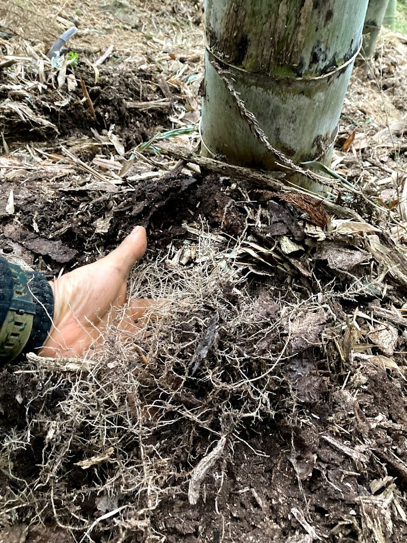

# Protocol 02: Spent Shiitake Logs × Moso Bamboo Stand Regeneration (Winter Bamboo Shoot Cultivation)
# プロトコル02：シイタケ廃ほだ木×孟宗竹林の育成（クリスマスのタケノコ掘り）

## Metadata / 基本情報
- **Protocol ID:** `BI-P02-SHIITAKE-LOGS-BAMBOO`
- **Location / 実施場所:** Minamiizu, Shizuoka, Japan（静岡県南伊豆町）
- **Baseline Reference / 基準資料:** 2021 Agro-Forestry Presentation (`../2021_noyorin_slides.pdf`, Slide 15)
- **Last Updated / 最終更新:** 2026-11
- **Core Synergy / 資源循環の構造:** Fungal-decomposed woody biomass (spent *Lentinula edodes* logs) → Forest-floor humus & rhizosphere activation → Off-season (winter) bamboo shoot production（シイタケ菌で適度に分解された廃ほだ木を竹林へ還元し、表土の腐植化と地下茎の活性化を通じて冬季タケノコ生産へ繋げる）

---

## 1. Input Volume & Application / 投入量と資材

| Parameter / 項目 | Value / 記録値 | Notes / 備考 |
| :--- | :--- | :--- |
| **Input Material / 投入資材** | **Spent shiitake mushroom logs (シイタケ廃ほだ木)** | Hardwood logs previously colonized and partially decomposed by shiitake mycelium (*Lentinula edodes*) |
| **Total Volume / 投入量** | **7 loads of a 2-ton dump truck (2tダンプ 7台分)** | Transported directly into the bamboo stand via forest road and dumped on-site |
| **External Synthetic Inputs / 化学資材** | **None (0)** | Zero chemical fertilizers, zero herbicides |

---

## 2. Temporal Response & Longitudinal Observations / 経時変化と現場観察

### Lead Time to Winter Shoot Emergence / 冬季タケノコ発生までの期間
- **Onset / 発生開始:** **From Year 2 post-application (投入から2年後より)**
- **Observed Phenomenon / 確認された現象:** Winter bamboo shoot harvesting ("Christmas bamboo shoot digging" / クリスマスのタケノコ掘り) became possible starting two years after introducing the spent logs.

### Rhizosphere & Soil Transformation (5-Year+ Follow-up) / 地下茎と表土の変化
- **Humus Formation / 腐植化:** Spent logs—pre-softened by shiitake mycelium—broke down into a dark, friable, moisture-retentive organic layer directly on the bamboo forest floor.
- **Root Proliferation / 強い発根:** Dense, vigorous networks of fine roots emerging directly from Moso bamboo rhizomes were confirmed throughout the decomposed log layer.

*Field evidence: Vigorous fine roots proliferating from bamboo rhizomes inside dark humus derived from decomposed spent shiitake logs.*

---

## 3. Mechanistic Notes / 構造メモ（きのこ×タケノコの相乗効果）
- **Pre-Digestion by Fungi (菌類による前処理):** Unlike raw wood waste, spent shiitake logs are already delignified and softened by white-rot fungi (*Lentinula edodes*), accelerating integration into the forest floor without causing nitrogen starvation.
- **Thermal & Moisture Buffering (保温・保湿マルチ効果):** The thick decaying wood and humus layer insulates the shallow rhizome zone during late autumn and winter, creating microclimatic conditions that support early/winter shoot development ("Christmas bamboo shoots").
- **Zero-Waste Forestry Loop (林業副産物の完全循環):** Converts an end-of-life byproduct of log-grown shiitake farming directly into high-value soil capital for bamboo shoot forestry.
