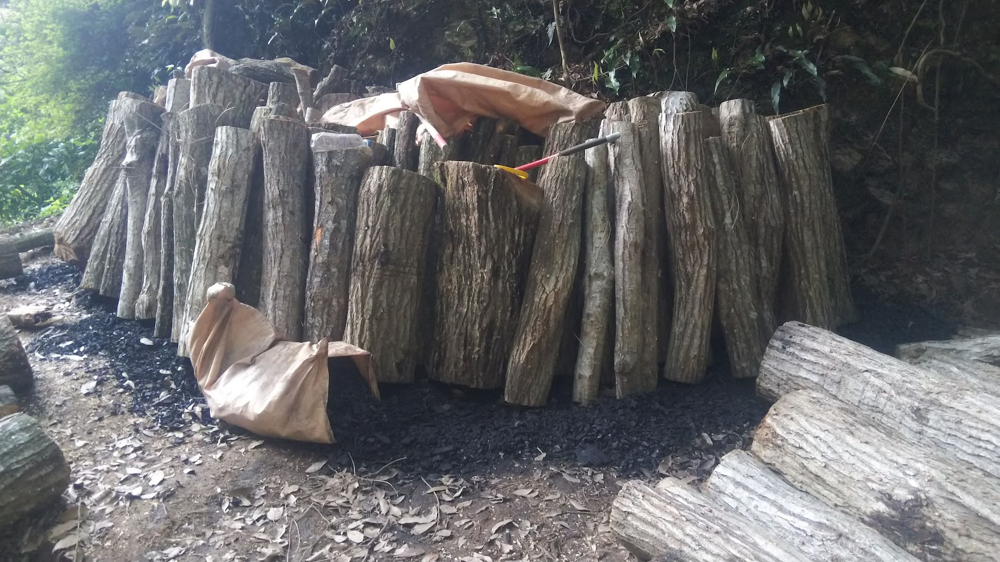
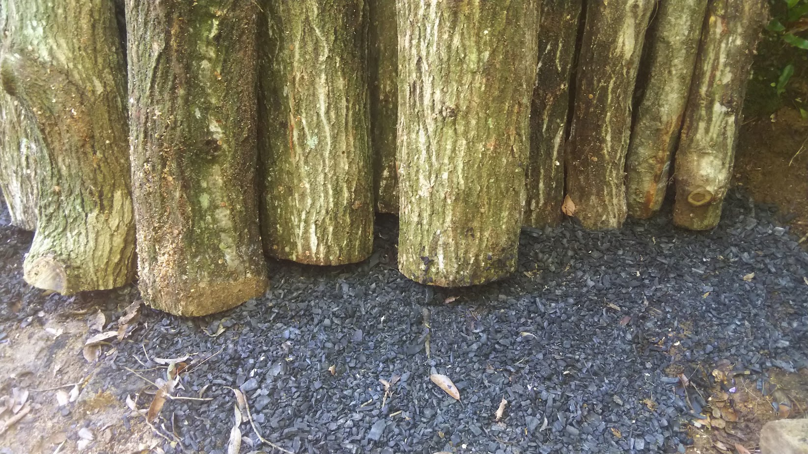
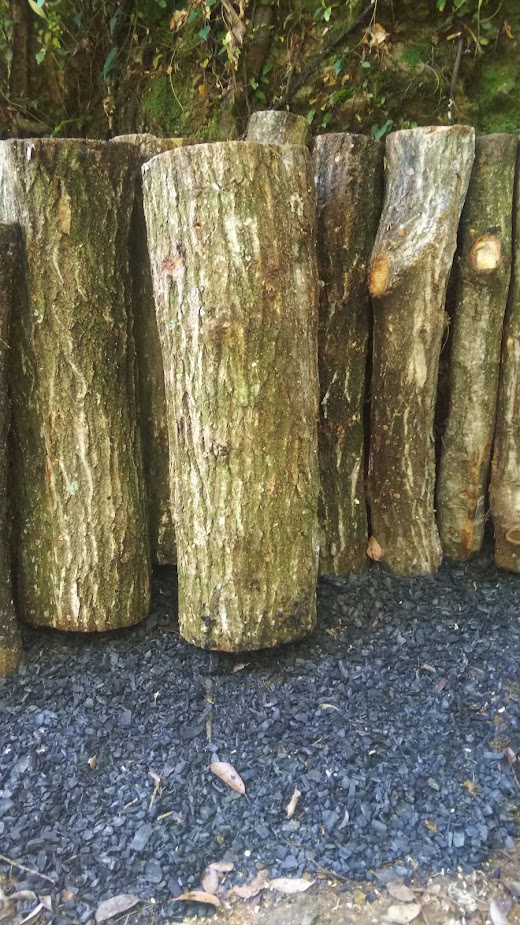
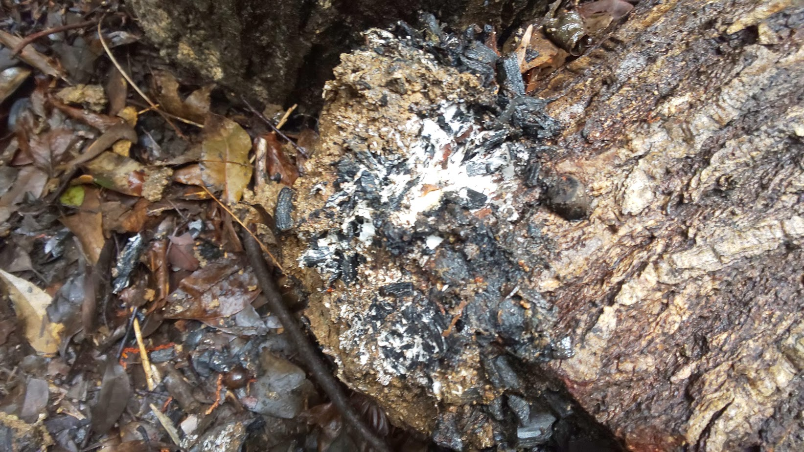
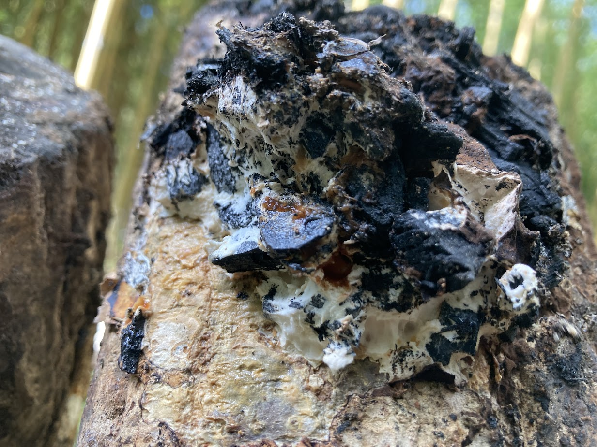
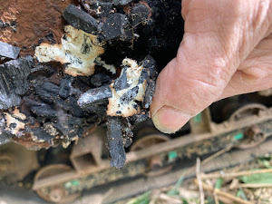

# Protocol 03: Porous Bamboo Charcoal Bed for Upright Shiitake Log Incubation (Multi-Year, Multi-Site Reproducibility)
# プロトコル03：ポーラス竹炭ベッドによる原木シイタケの縦置き仮伏せ（異年次・異場所での再現性と寿命検証）

## Metadata / 基本情報
- **Protocol ID:** `BI-P03-CHARCOAL-BED-KARIBUSE`
- **Location / 実施場所:** Minamiizu, Shizuoka, Japan（静岡県南伊豆町・複数サイト）
- **Host Wood Species / 原木樹種:** **100% Konara oak (*Quercus serrata*)**（すべてコナラ）
- **Case 1 (Site A — Late-Season Full Lifecycle / 現場A・遅打ち〜寿命全う):**
  - Setup / 菌打ち・仮伏せ: **2019-05-07**
  - Basal Mycelium Check / 活着確認: **2019-12-23** (+230 Days)
  - Fruiting Lifespan / 発生期間: **Produced without issue through 2025** (~6.5 years post-inoculation; natural exhaustion reached in 2026)
- **Case 2 (Site B — Reproducibility Verification / 現場B・再現性確認):** **2025-11-18** (Different site, upright placement)
- **Core Finding / 核心知見:** Upright placement of inoculated *Quercus serrata* shiitake logs directly on granular porous bamboo charcoal suppresses ground-contact competitor molds, drives vigorous mycelial binding of charcoal particles, and enables even high-risk late-season (May) logs to complete a full ~6.5-year fruiting lifecycle—replicated across a 6-year span and different sites.

---

## 1. Case 1 (2019–2026, Site A): Late-Season Stress Test & Full Lifecycle / 事例1（現場A）：GW遅打ちのストレステストと寿命全う

- **Operational Constraint / 現場制約:** Peak spring bamboo shoot harvesting delayed shiitake inoculation on *Quercus serrata* (Konara) logs until Golden Week (**2019-05-07**), far later than the standard cool-season window in warm-temperate Minamiizu.
- **Setup / 施工:** Spread granular porous bamboo charcoal across the slope base and stood inoculated Konara logs upright directly on the charcoal bed.
- **Incubation Result (+230 Days / 2019-12-23):** After enduring the full rainy season and summer heat, ground-contact cut ends remained free of severe *Trichoderma* / mold decay; dense white shiitake mycelium grew out from the wood and physically bound the charcoal particles and surrounding soil.
- **Full Fruiting Outcome (through 2025 / ~6.5 Years):** Despite late-season inoculation on relatively thin-barked Konara oak, the logs fruited consistently without operational issues through **2025**, reaching natural senescence in **2026**. The spent logs then transition directly into forest-floor humus cycling (`Protocol 02`).

---

## 2. Case 2 (2025, Site B): Multi-Site Reproducibility / 事例2（2025年・現場B）：異なる場所での再現性確認

- **Date / 確認日:** **2025-11-18**
- **Condition / 条件:** Upright placement (*tate-oki*) of Konara logs on porous bamboo charcoal at a **different site** from the 2019 trial.
- **Observation / 観察結果:** Replicated the exact charcoal-binding behavior observed six years earlier—thick, vigorous white mycelial mats completely enveloped angular porous bamboo charcoal fragments, accompanied by glossy amber metabolic exudate droplets indicating high fungal vitality.

---

## 3. Mechanistic Notes / 構造メモ
- **Drainage & Aeration Interface (排水・通気界面):** Granular porous charcoal prevents stagnant water and mud splash at the vulnerable lower cut end of upright logs.
- **Zero-Chemical Fungal Dominance (無農薬での菌勢優位):** Creates a well-aerated, redox-balanced physical scaffold at the soil–wood boundary where *Lentinula edodes* outcompetes anaerobic and opportunistic molds—preserving full log longevity (~6.5 years) even under late-season heat stress.
- **Circular Integration (循環接続):** Upon natural exhaustion in Year 7 (2026), spent logs feed directly into bamboo forest humus regeneration (`Protocol 02`).
