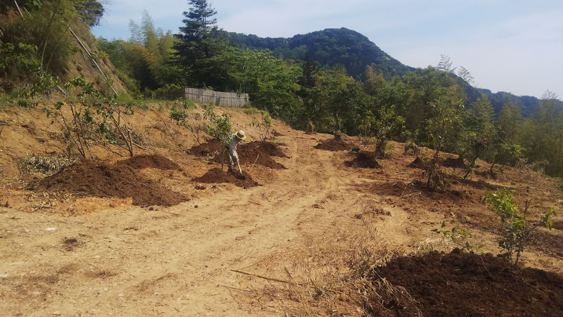
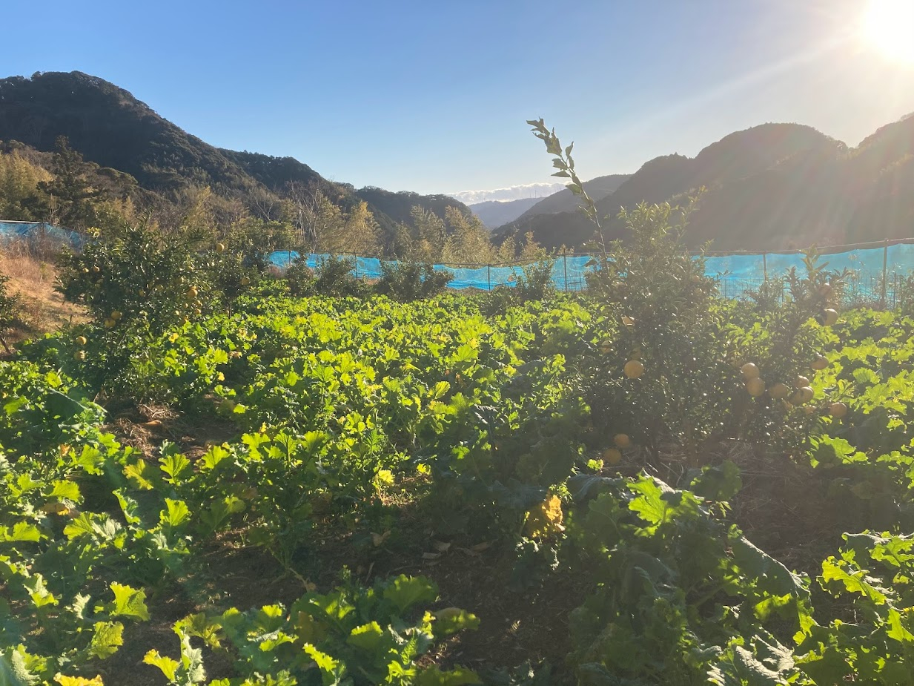

# Protocol 04: Bare Subsoil Recovery & Citrus–Nabana Intercropping Using Bamboo Chip Compost Alone
# プロトコル04：竹チップ堆肥単独による裸地再生と柑橘（はるか）・なばな混植の実証

## Metadata / 基本情報
- **Protocol ID:** `BI-P04-COMPOST-ONLY-RECOVERY`
- **Location / 実施場所:** Minamiizu, Shizuoka, Japan（静岡県南伊豆町）
- **Baseline (Before) / 施工時:** **2018-05-22**（裸地への竹チップ堆肥施用）
- **Follow-up (After) / 経過確認:** **~2022-01**（令和4年1月頃・約3年8ヶ月後 / ~44 months）
- **Input / 投入資材:** **Bamboo chip compost only**（竹チップ堆肥のみ / Reference: `Protocol 01`）
- **Vertical Charcoal Shafts / 縦穴竹炭打設:** **None（打設なし）** — Variable-isolated control case
- **Crops / 栽培作物:**
  - Orchard tree / 果樹: **Haruka citrus (*Citrus* 'Haruka')**（はるか）
  - Intercrop / 混植・下草作物: **Nabana (*Brassica* greens)**（なばな）
- **Core Finding / 核心知見:** Even without vertical charcoal shaft installation, heavy surface mounding of fermented bamboo chip compost around young citrus trees transformed exposed, barren subsoil into a biologically active orchard floor supporting both fruiting Haruka citrus and dense winter Nabana intercropping within ~3.7 years.

---

## 1. Baseline Condition & Application (2018-05-22) / 裸地への竹チップ堆肥施用

- **Initial Site State / 初期状態:** Exposed, compacted yellow-brown subsoil with virtually no groundcover vegetation; young Haruka citrus saplings planted along the slope.
- **Treatment / 施用方法:** Applied generous mounds of dark, fermented bamboo chip compost directly around the base of each sapling. **No vertical charcoal shafts were installed at this site**, isolating the effect of bamboo chip compost as a standalone soil-building input.

---

## 2. Recovery Result (~2022-01 / +3 Years 8 Months) / 約3年8ヶ月後の再生状況

- **Same-Ridge Fixed-Point Verification / 同一稜線での定点確認:** Viewed against the same background mountain ridge, the once-barren ground is completely covered by vigorous winter **Nabana** foliage acting as both an edible crop and living mulch.
- **Fruiting Performance / 果樹の結実:** The **Haruka** citrus trees developed healthy canopies and bore abundant bright-yellow winter fruit.
- **Data Value for Comparative Analysis / 比較データとしての意義:** Confirms the standalone surface-soil regeneration capacity of `Protocol 01` (bamboo chip compost) on bare land, providing a clean baseline distinct from sites utilizing deep vertical porous bamboo charcoal shafts.

